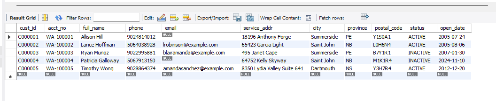
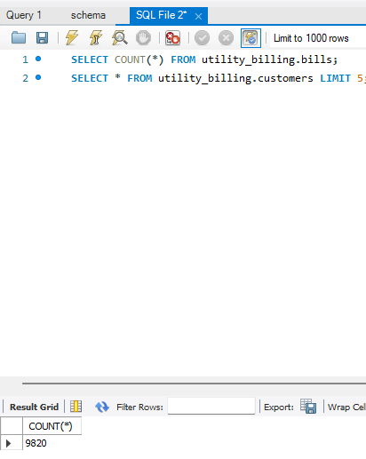

# Utility Billing ETL

Migrates a synthetic legacy utility billing export (customers, meters, bills)
into a clean, normalized MySQL database, with data profiling, validation,
and reconciliation. All data is synthetic, generated by `generate_legacy_data.py`.

## Project status
- [x] Phase 1: generate messy legacy data
- [x] Phase 2: profile the source data
- [x] Phase 3: design the target schema
- [x] Phase 4: transform and clean
- [x] Phase 5: load into MySQL
- [x] Phase 6: reconcile and audit

## Tech
Python, pandas, SQL, MySQL, SQLAlchemy

## How to run
1. `pip install -r requirements.txt`
2. `python generate_legacy_data.py` (creates the CSVs in `data/legacy/`)
3. `python profile.py` (prints a profile and saves `output/profile_report.txt`)

## What I found

- **Customers:** I need to standardize `PROV` (13 values for 3 provinces), `STATUS` (7 values), `PHONE` (5 formats), `POSTAL` (3 formats), and `OPEN_DT` (3 date formats). `ACCT_NO` has 3 shapes: one valid format and two ways of leaving it blank.
- **Meters:** `METER_TYPE` has 8 values for 3 types, `STATUS` has 6 values, and `INSTALL_DT` has 3 date formats. I would make these consistent before using the data.
- **Bills:** `PERIOD_START`, `PERIOD_END` and `BILL_DT` each have 3 date formats. `AMT_BILLED` has 9 formats and `AMT_PAID` has 11, counting blanks, so I'd remove dollar signs and commas and store amounts as numbers.
- **Fix or reject:**
  - **Fix:** inconsistent labels, phone and postal formats, and dates.
  - **Merge:** the 120 extra customer rows share a `CUST_ID` and `ACCT_NO` with another row, so they are duplicates. I'd merge them with a written survivorship rule and log them as merged, not rejected.
  - **Reject:** the 40 customers with missing account numbers, the 60 meters with unknown customers, and the 150 bills with unknown meters.
  - **Investigate:** the 30 missing billed amounts. The 500 missing paid amounts probably just mean unpaid bills.
- **What the profile can't tell me on its own:** A date like `02/03/2024` could mean February 3 or March 2. I'd check the source system's date rules and compare unambiguous dates (like `02/21/2008`) before converting everything to one format.
  **Verified:** of 11,533 slash-format dates, 0 have a first number above 12 and 9,799 have a second number above 12, so the format is `MM/DD/YYYY`.

## Mapping: legacy source to target

### customers (`customers.csv` to `customers`)
| Source | Target | Rule |
|---|---|---|
| `CUST_ID` | `cust_id` | Copy as is. If a `CUST_ID` appears more than once, keep the first row and log the extras as `MERGED_DUPLICATE`. |
| `ACCT_NO` | `acct_no` | Strip spaces. Blank, whitespace-only or missing: **reject** (`MISSING_ACCT_NO`). |
| `FULL_NAME` | `full_name` | Strip, collapse repeated spaces, convert to Title Case. |
| `PHONE` | `phone` | Keep digits only. If 11 digits starting with `1`, drop the `1`. If not 10 digits, load as `NULL` and log a warning. |
| `EMAIL` | `email` | Strip, lower case. Blank becomes `NULL`. |
| `SVC_ADDR` | `service_addr` | Strip. |
| `CITY` | `city` | Strip, Title Case. |
| `PROV` | `province` | Map all spellings to a 2-letter code: `PE`/`P.E.I.`/`PEI`/`Prince Edward Island`/`pe` to `PE`; `NS`/`N.S.`/`Nova Scotia`/`ns` to `NS`; `NB`/`N.B.`/`New Brunswick`/`nb` to `NB`. Anything else: **reject** (`UNKNOWN_PROVINCE`). |
| `POSTAL` | `postal_code` | Remove spaces, upper case. Must be 6 characters, otherwise **reject** (`BAD_POSTAL`). |
| `STATUS` | `status` | `A`/`ACTIVE`/`Active` to `ACTIVE`; `I`/`INACTIVE` to `INACTIVE`; `C`/`CLOSED` to `CLOSED`. Anything else: **reject** (`UNKNOWN_STATUS`). |
| `OPEN_DT` | `open_date` | Parse `YYYY-MM-DD`, `MM/DD/YYYY` (month first, verified in profiling) or `DD-Mon-YYYY` into a `DATE`. Unparseable: **reject** (`BAD_DATE`). |

### meters (`meters.csv` to `meters`)
| Source | Target | Rule |
|---|---|---|
| `METER_ID` | `meter_id` | Copy as is. |
| `CUST_ID` | `cust_id` | Must exist in the loaded `customers`, otherwise **reject** (`ORPHAN_CUSTOMER`). |
| `METER_TYPE` | `meter_type` | `WATER`/`WTR`/`water` to `WATER`; `ELEC`/`ELECTRIC`/`electric` to `ELECTRIC`; `GAS`/`gas` to `GAS`. Anything else: **reject** (`UNKNOWN_METER_TYPE`). |
| `INSTALL_DT` | `install_date` | Same three date formats as above, into a `DATE`. |
| `STATUS` | `status` | `A`/`ACTIVE`/`Active` to `ACTIVE`; `I`/`INACTIVE` to `INACTIVE`; `RETIRED` stays `RETIRED`. Anything else: **reject** (`UNKNOWN_STATUS`). |

### bills (`bills.csv` to `bills`)
| Source | Target | Rule |
|---|---|---|
| `BILL_ID` | `bill_id` | Copy as is. |
| `METER_ID` | `meter_id` | Must exist in the loaded `meters`, otherwise **reject** (`ORPHAN_METER`). |
| `PERIOD_START` | `period_start` | Parse the three date formats into a `DATE`. |
| `PERIOD_END` | `period_end` | Same. Must not be before `period_start`, otherwise **reject** (`BAD_PERIOD`). |
| `BILL_DT` | `bill_date` | Same date parsing. |
| `USAGE` | `usage_amount` | Convert to `DECIMAL(12,1)`. |
| `AMT_BILLED` | `amt_billed` | Strip `$` and `,`, convert to `DECIMAL(10,2)`. Blank: **reject** (`MISSING_AMOUNT`). |
| `AMT_PAID` | `amt_paid` | Strip `$` and `,`, convert to `DECIMAL(10,2)`. Blank becomes `0.00` (assumption: unpaid, to confirm with the client). |

### Global rules
- Every column is read as text first, so pandas can't silently change values.
- Rejected rows go to `output/rejects.csv` with the table name, source key and a reason code. Nothing is silently dropped.
- Loading order is `customers`, then `meters`, then `bills`, because of the foreign keys.
- Rejects cascade down the chain: a meter is checked against the customers that actually loaded, and a bill against the meters that actually loaded.


Date handling: Dates arrive in three formats. parse_dates matches each value to a format by pattern and parses it with that explicit format, never auto-detecting. Slash dates are MM/DD/YYYY, verified during profiling. Values matching no format are rejected as BAD_DATE with the original text logged.


### Result in MySQL

Cleaned customers loaded into MySQL (standardized province, status, postal code, real dates, true NULLs for missing emails):

```sql
SELECT * FROM utility_billing.customers LIMIT 5;
```



Bills loaded (9,820 of 10,000 source rows; the rest are logged as rejects):

```sql
SELECT COUNT(*) FROM utility_billing.bills;
```

